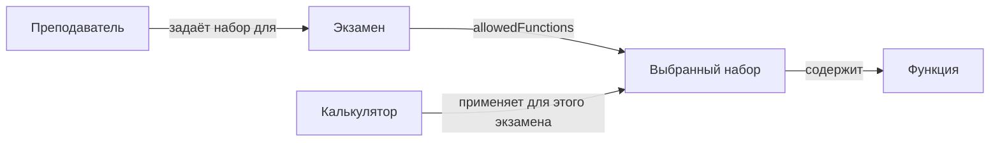

# Exam calculator: from a desired result to two action relationships

**Что хочет человек:** на университетском планшете один и тот же калькулятор можно использовать на разных экзаменах; доступные функции зависят от экзамена. Чтобы проверить этот результат, достаточно попробовать одну операцию на двух экзаменах. Человеку не требуется знать имена классов или грамматику пакета.

**Как к этому прийти:** «Преподаватель задаёт для экзамена набор разрешённых функций, а калькулятор применяет этот набор». Это согласованное уточнение. [Исходная цитата и четыре ожидаемых наблюдения](intent.json) хранятся отдельно от [модели агента](../../SPECS/ontology/packages/examcalc/versions/0.2.0-draft.1/domain-ontology-package.yaml) и её исполнения. Цитата прослеживается до сообщения пользователя по `messageId`; названия экзаменов, наборов и функций в проверке — лишь данные примера.

| Слова | Что выражает пакет | Что должно измениться |
|---|---|---|
| «Преподаватель задаёт для экзамена набор» | `Instructor → SetAllowedFunctions(functions: Ref<AllowedFunctionSet>) → Exam` | У конкретного экзамена появляется ссылка `allowedFunctions` на выбранный набор. |
| «Калькулятор применяет этот набор» | `Calculator → ApplyAllowedFunctions(exam: Ref<Exam>) → AllowedFunctionSet` | Для указанного экзамена калькулятор допускает выполнение только функций этого набора. |
| «Набор разрешённых функций» | `AllowedFunctionSet → includesFunction → CalculatorFunction` | Это состав набора. Никому не нужно выполнять действие «включает» при каждой проверке. |

У первой фразы есть исполнитель, действие, объект и параметр. Во второй слова «этот набор» ссылаются на тот же самый набор для того же экзамена. Это сильнее, чем совместимость типов: два разных набора могут даже содержать одинаковые функции. У свойства экзамена нет значения до назначения. Слов «ровно один активный профиль», требований к подписи, аудиту или сети в исходной реплике нет. Эти условия принадлежат [историческому примеру 0.1](../../SPECS/ontology/packages/examcalc/README.md#historical-golden-010).



## Откуда берётся ограничение

Можно объяснить правило для арифметики словами преподавателя. «Я выбираю базовый набор. Когда калькулятор применит его к этому экзамену, сложение будет работать. Синус в мой набор не входит, поэтому калькулятор его не вычислит».

**Если на весь экзамен выбран один набор**, преподаватель задаёт его заранее, калькулятор применяет его на планшете, и студент получает подготовленный планшет. К моменту выдачи должен действовать набор именно этого экзамена. [Проверка выдачи](#проверка-выдачи)

Следующая таблица показывает, как тест различает выбор и применение. Он сам вызывает `sin(0)` и между действиями, и после них, в том числе при искусственной замене набора. Эти наблюдения принадлежат тесту. [Исполняемая проверка](verify.ts)

| Момент на экзамене по арифметике | Выбранный набор | Применённый набор | Попытка `sin(0)` |
|---|---|---|---|
| До выбора | нет | нет | Решение неизвестно |
| Преподаватель задал набор | `basic` | нет | Решение неизвестно |
| Калькулятор применил набор | `basic` | `basic` | Функция недоступна |
| Преподаватель выбрал набор с синусом | `arithmetic-plus` | `basic` | Решение неизвестно |
| Калькулятор применил новый набор | `arithmetic-plus` | `arithmetic-plus` | Функция вызвана и вернула `0` |

Здесь «применённый набор» означает последний набор, который калькулятор успешно применил **для указанного экзамена**. В проверках по тригонометрии это был `scientific`, и вызов синуса возвращал ноль до, во время и после замены набора для арифметики. Для выдачи нужно дополнительно знать, какой из экзаменов сейчас активен на самом планшете.

**Если экзамен состоит из секций с разными наборами**, переход виден студенту. Студент мог бы подтвердить переход из секции A в B. Тогда калькулятор приостанавливает вычисления на этом планшете, активирует набор B и только потом возобновляет работу в секции B. Проверить такой переход можно на функции, разрешённой в A и запрещённой в B. Во время переключения она не должна выполняться, а после открытия B калькулятор должен её отклонить. Это кандидат для отдельной спецификации.

## Проверка выдачи

В сценарии `examcalc.handoff-ready` экзамен студента задан независимо от подготовки планшета. При каждом успешном применении калькулятор одновременно записывает две типизированные ссылки — `activeExam` и `activeFunctions`. При попытке выдачи он сверяет первую с экзаменом студента, а вторую с текущим выбором преподавателя для этого экзамена. При совпадении обеих возвращается планшет с идентификаторами активного экзамена и набора. [Критерий и входные примеры](intent.json) · [Исполняемый сценарий](verify-handoff.ts)

| Экзамен студента | Выбрано для него | Активно на планшете | Выдача |
|---|---|---|---|
| Арифметика | `basic` | Ещё ничего | Отказ |
| Арифметика | `basic` | Арифметика, `basic` | Разрешена |
| Арифметика | `basic` | Тригонометрия, тот же `basic` | Отказ |
| Тригонометрия | `basic` | Тригонометрия, `basic` | Разрешена |
| Тригонометрия | `basic-copy` | Тригонометрия, прежний `basic` | Отказ |

В последней строке наборы разрешают одинаковые функции. После применения именно `basic-copy` выдача проходит. Это проверка готовности локальной модели в момент передачи.

## Первое нажатие после выдачи

Студент получает планшет для своего экзамена и нажимает `tablet.sin(0)`. Он передаёт только число. Калькулятор проверяет, что экзамен и набор при выдаче по-прежнему активны и соответствуют выбору преподавателя. Затем он проверяет, входит ли синус в набор, и при разрешении вызывает `Math.sin`.

| Выданный планшет | Нажатие | Вызов вычисления | Что видит студент |
|---|---|---|---|
| Арифметика, `basic` | `sin(0)` | 0 раз | Функция недоступна |
| Тригонометрия, `scientific` | `sin(0)` | 1 раз | Число `0` |

Если до нажатия планшет настроили для другого экзамена, прежняя выдача возвращает `unknown`, даже когда у обоих экзаменов один набор. Проверка относится к состоянию в момент нажатия. Ожидания сохранены отдельно от приложения. [Критерий `examcalc.first-student-operation`](intent.json) · [Сценарий нажатия](verify-handoff.ts)

## Исполняемая проверка

[Чтение фразы](reading.ts) распознаёт только эти две конструкции и связывает «этот набор» с первым действием. Входной сценарий передаёт экземпляры по локальным именам; их можно также указать внутри первой фразы: `для экзамена «arithmetic» набор разрешённых функций «basic»`. Неизвестная конструкция или «этот набор» без предшественника дают ошибку. Это маленький словарь примера: `ontologyc` сам проверяет YAML, а не распознаёт произвольную речь. Интерпретацию предлагает агент, а критерий результата можно сохранить и при другом способе реализации.

[Исполнитель](calculator.ts) использует `Actor` и `trigger` из SDK, который генерируется из пакета. [Сценарий](verify.ts) сначала назначает оба набора и лишь затем применяет их на одном калькуляторе. Сложение доступно в обоих случаях. Попытка вычислить `sin(0)` на арифметике не вызывает операцию; на тригонометрии она выполняется и возвращает ноль. Попытка подставить посторонний набор не меняет доступность. При отсутствии выбора этот пример сообщает `unknown`; явно пустой набор не разрешает ни одной функции. Реакция будущего продукта на отсутствие выбора остаётся открытой.

From the repository root, with Swift and Node installed:

```sh
swift build --product ontologyc
bin="$(swift build --show-bin-path)/ontologyc"
"$bin" check SPECS/ontology/packages/examcalc/versions/0.2.0-draft.1/domain-ontology-package.yaml
bash tools/typescript-smoke.sh "$bin"
```

The first check validates the declarations. The last command compiles the package, type-checks the consumer, and runs the exam scenarios alongside the existing SDK smoke cases. Neither check deploys a tablet app or certifies its security.
