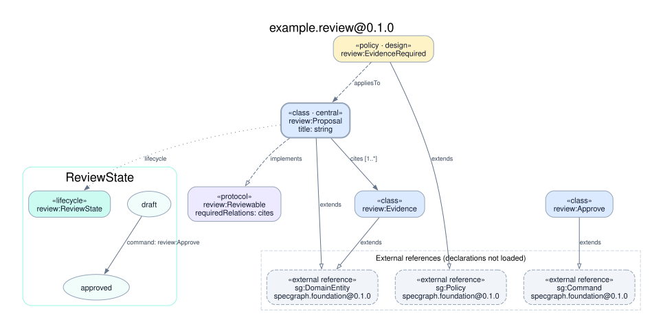
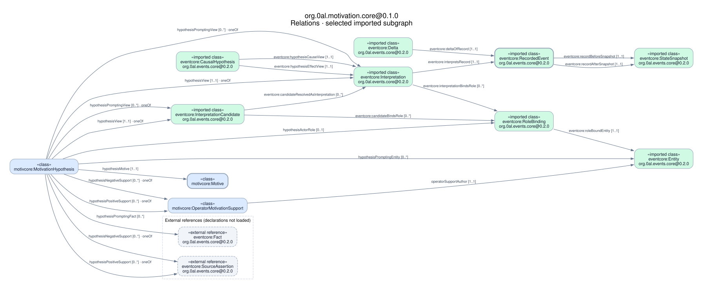

# Visualize an ontology package

`ontologyviz` draws a package locally and writes SVG, PNG and the DOT source.
The example models a proposal citing evidence, its review protocol and policy,
and an explicit approval transition.



The checked-in preview uses `--direction TB` and Graphviz 16.1.0.

## Run

Build with Swift 6.0 or later. Install Graphviz for SVG and PNG output.

```sh
# macOS
brew install graphviz
# Debian / Ubuntu
sudo apt-get install graphviz

swift run ontologyviz \
  Examples/package-visualization/domain-ontology-package.yaml --out diagrams
```

The default produces `diagrams/ontology.dot`, `diagrams/ontology.svg` and
`diagrams/ontology.png`. Output paths are printed to stdout and errors to stderr.
Select a single image format or export DOT on its own with `--format svg`,
`--format png` or `--format dot`. Every mode retains the DOT source.

```sh
swift run ontologyviz --direction TB --format svg \
  SPECS/ontology/packages/examcalc/domain-ontology-package.yaml --out diagrams/examcalc
swift run ontologyviz package.yaml --out diagrams --dot /opt/homebrew/bin/dot
swift run ontologyviz --help
```

`--direction LR` is the default. Options may precede or follow the input.
`--out` selects a directory. Existing artifacts with the selected names are
replaced after all requested renderer operations succeed. Rendering errors
preserve the previous artifacts. Files from formats omitted in a subsequent run
remain in that directory, so use a fresh output directory when publishing a
complete set. Output publication uses atomic writes per file, not a directory
transaction.

## Read the diagram

| Appearance | Meaning |
|---|---|
| Blue box | Class, including scalar fields and optional `?` markers |
| Thick blue border | Class marked `central` |
| Purple box and dashed `implements` arrow | Protocol and conformance |
| Amber box and dashed `appliesTo` arrow | Policy and its declared targets |
| Hollow `extends` arrow | Inheritance |
| Named solid arrow | Relation with `[min..max]` cardinality when declared |
| Several arrows labeled `oneOf` | Alternative relation ranges |
| Teal group | Lifecycle states and transitions labeled with command/event refs |
| Dashed gray box | External concept reference with the declared import version |
| Green box | Explicitly selected class loaded from a supplied local import |

An omitted cardinality bound is shown as `?` when the other bound is present.

## Relations view and selected imports

Use `--view relations` to inspect domain relations. This view shows root classes
incident to the root's relations and retains every root relation. Class fields,
inheritance, protocols, policies and lifecycle declarations are outside this view.
The default `--view full` retains the complete package diagram.

To inspect a path across package boundaries, explicitly supply local YAML files
and select the imported classes to expand. This motivation-core example exposes
the interpretation, actor role, causal view, registered record, snapshots and Delta.

```sh
swift run ontologyviz \
  SPECS/ontology/packages/motivation-core/domain-ontology-package.yaml \
  --view relations \
  --import SPECS/ontology/packages/events-core/versions/0.2.0/domain-ontology-package.yaml \
  --expand eventcore:Interpretation,eventcore:InterpretationCandidate \
  --expand eventcore:RoleBinding,eventcore:Entity,eventcore:CausalHypothesis \
  --expand eventcore:RecordedEvent,eventcore:StateSnapshot,eventcore:Delta \
  --out diagrams/motivation-relations
```



The same selection is saved in
[motivation-relations.profile.json](motivation-relations.profile.json).

```sh
swift run ontologyviz \
  --profile Examples/package-visualization/motivation-relations.profile.json \
  --out diagrams/motivation-relations
```

`--import` and `--expand` can be repeated. Each supplied package must match one
direct root import by exact id/version, with an unambiguous namespace. Use the
root import alias in selectors, even when the supplied package uses a different
canonical namespace. Unknown classes, duplicate supplied imports, wrong versions
and ambiguous aliases are errors. These options require relations view and must
be supplied together. Inputs are explicit local files; no network or sibling
directory discovery occurs.

For imported packages, the displayed relations form the induced subgraph of the
selected classes and known root classes. A relation appears only when its domain
and **every** range alternative are in that set. A partially selected `oneOf`
relation is omitted as a whole. Root relations stay complete and unselected root
targets remain gray external references. All explicitly selected imported classes
appear, including isolated selections. Green nodes show the actual loaded
declarations and source id/version. A caption identifies the selected view.

The diagram shows types. The own record and downstream effect record in the
README's example share the `RecordedEvent` type here. Different occurrences,
actor bindings, snapshot instances, truth and causal validity require their own
instance representation and validation. Local identity/version matching identifies
the supplied files and does not authenticate their source or enforce a separate
consumer's digest pin.

## Saved profiles

Profiles are local JSON files using the
[diagram profile schema](../../SPECS/ontology/diagram-profile.schema.json).
A minimal full-package profile needs two fields.

```json
{
  "schemaVersion": 1,
  "package": "../packages/example/domain-ontology-package.yaml"
}
```

| Field | Meaning |
|---|---|
| `schemaVersion` | Required integer `1` |
| `package` | Required local YAML path |
| `view` | `full` by default, or `relations` |
| `direction` | `LR` by default, or `TB` |
| `imports` | Local package paths, default `[]` |
| `expand` | Selectors with the same syntax as repeated `--expand`, default `[]` |
| `$schema` | Optional editor hint, consumed as a string without fetching it |

Package/import paths resolve relative to the profile's actual directory. A
symlink to a profile uses the target file's directory. Absolute local paths also
work. The profile path itself is looked up from the invocation directory.
Output paths supplied by `--out` remain relative to that invocation directory.

`--profile` excludes a positional package and `--view`, `--import`, `--expand`.
CLI `--direction` overrides a valid profile direction. Choose `--format`, `--out`
and `--dot` at runtime. The profile stores the repeatable diagram selection;
the output destination is explicitly required for each invocation.

```sh
ontologyviz --profile motivation-relations.profile.json --format svg --out diagrams
ontologyviz --profile motivation-relations.profile.json --direction TB --out diagrams
```

Unknown fields, explicit nulls, wrong types and unsupported schema versions are
configuration errors with exit code `2`. The same runtime selection/import checks
apply after loading a profile. For relations view, local imports and expanded
selectors must be supplied together. Invalid package or dependency content retains
exit code `1`. Output replacement protection covers the profile and all package
inputs. Profiles can be committed alongside the code/specifications they describe.

The schema provides structural validation for editors. Runtime checks also enforce
option combinations, reference selection and exact imported package identity/version.

Unexpanded external placeholders carry no claim of successful symbol resolution in the
imported package. Package loading and validation reuse the compiler's current
checks. The diagram is a schema view, including declared behavior structure;
policy text and actual runtime observations require their own review.

DOT output is deterministic for a fixed package and direction. Layout, fonts and
raster pixels depend on the installed Graphviz version and font environment.
SVG and PNG are rendered independently from the same DOT graph. PNG is Graphviz's
raster rendering of that graph.

The tool passes generated DOT through an argument-array invocation of local
Graphviz. Package strings are quoted as text. It performs no remote rendering.
Graphviz is an external dependency under its own license and is not bundled into
the Swift executable. See [Graphviz](https://graphviz.org/license/).

The examples that informed this interface are [Ondine](https://github.com/wevm/ondine)
and [Pumlpad](https://github.com/krus210/pumlpad). They remain independent projects.

## Exit codes and testing

- `0` means the requested files were generated successfully.
- `1` means package validation, local rendering or file I/O failed.
- `2` means invalid arguments.

The normal Swift test suite runs real SVG and PNG rendering tests. Install
Graphviz before `swift test` or `bash tools/swift-quality.sh`. The macOS and Linux
CI jobs install it explicitly. With an external SwiftPM scratch directory, build
the executables and set `ONTOLOGYC_TEST_BINARY_PATH` to that directory's
`debug/ontologyc`; the CLI tests find `ontologyviz` beside it.
