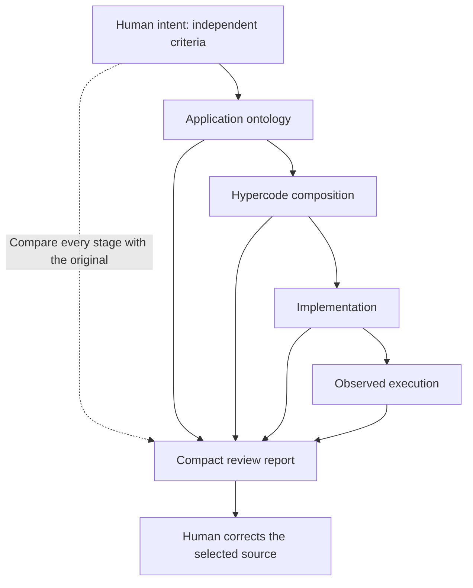
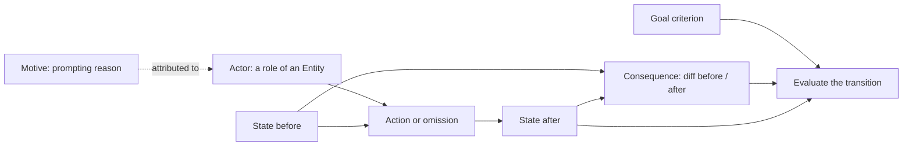

# Ontology

**Make meaning reviewable—from human intent to running software.**

AI can write an application faster than its owner can read the code. The hard
question is whether it built the application the owner meant. A program can pass
its tests, follow its generated design and still implement the wrong requirement.

Ontology makes that question concrete. It provides **versioned domain models**,
a compiler that checks their structure, and working experiments that show **what
changed in meaning at each step from intent to execution**. The aim is to let a
person review a small model and a short semantic diff, find a mistranslation and
correct its source.

The repository connects two applications of the same idea: preserving intent in
AI-assisted programming and making interpretations of events and rules explicit
in [NormLab](https://github.com/SoundBlaster/NormLab), a laboratory for executable
legal models. **Lean** supplies formal verification in NormLab; this repository
supplies reusable vocabulary, structural checks and bounded review experiments.

[Try the image pilot](Examples/intent-preservation/README.md) ·
[Model an action](skills/ontology-action-model/references/modeling.md) ·
[Build the compiler](#try-it) ·
[Read the review contract](SPECS/intent-preservation/0.1/README.md)

## The problem: a correct implementation of the wrong idea

Suppose the requirement is: **make this image at least 200 kB smaller, keep its
dimensions, and overwrite the same selected file**.

An AI-generated design chooses to resize the image. The implementation follows
that design. The output is smaller and the operation succeeds. Checking only
implementation against design misses the original requirement.

The [executable image pilot](Examples/intent-preservation/README.md) deliberately
creates this mistake. It compares every stage with its predecessor **and with the
original intent**, then runs the image operation and measures the result.

| What the reader sees | Result in the deliberate resize case |
|---|---|
| Original intent | Preserve image dimensions |
| Hypercode and implementation | Both request resizing |
| Execution | The configured resize succeeds |
| Size goal | Achieved |
| Intent correspondence | **Violated: dimensions were changed** |

The report names the affected requirement, the transition where its meaning
changed and the source to edit. Unchanged mappings can be collapsed. Missing
evidence remains unknown. The original intent is never rewritten to fit the code.



This chain runs today for a bounded image example. An independent
[edit-cancellation example](Examples/edit-cancellation/README.md) uses the same
report contract: the operation can complete while leaving edits that the user
asked to cancel. Its smaller chain uses local declarations rather than Hypercode.

## A small model of actions and consequences

Start with the things the application acts on, their identity, and what may change.
The same image file can remain the same entity while its bytes and size change.
The operator can be the actor and the encoder an instrument. Another interpretation
can model the encoder as the actor. These choices are explicit because they affect
the design of the application.



This is a modeling pattern, not a claim that every arrow is automatically inferred
or formally proved. The [worksheet](skills/ontology-action-model/assets/action-model.md)
makes the chosen scope and interpretation explicit.

| Concept | What it keeps distinct |
|---|---|
| **Entity and roles** | Identity versus actor, object or instrument in a particular interpretation. An actor can be a person, community, AI, machine or natural phenomenon. |
| **Event and interpretation** | A recorded occurrence and its states versus the roles and causal explanation assigned to it. |
| **State and Delta** | What is represented before/after versus exactly what changed. Unknown states do not imply an empty diff. |
| **Motive, goal and intention** | A prompting reason, a desired condition and a commitment to act. A motive need not be conscious; none proves an actual outcome. |
| **Responsibility** | A separate profile with explicit grounds. Acting, causing change or having a motive alone does not establish liability. |

A goal may concern the final state, the difference, or the whole transition:
“at most 500 kB” and “at least 200 kB smaller” are different requirements.
The evaluator applies that criterion to observations. For an omission, its own
record can have an empty Delta while a separate event has a hypothesized downstream
consequence; the causal link remains an explicit hypothesis.

## What you can use today

| Component | Delivered capability |
|---|---|
| **`ontologyc`** | Static Swift compiler: validate inert YAML packages, emit deterministic normalized IR and TypeScript SDK artifacts, compare versions and resolve semantic references. Runs on macOS and Linux. |
| **[Event models](SPECS/ontology/packages/events-core/README.md)** | Draft vocabulary for entities, events, interpretations and state changes, with an implemented [bounded InstanceGraph validator](SPECS/ontology/instance-graph/README.md). |
| **[Snapshot provenance](SPECS/ontology/instance-graph/provenance/README.md)** | An explicit profile for admissible state origins and candidate enrichment. Source presence, accepted provenance and factual truth are separate. |
| **[Responsibility](SPECS/ontology/packages/responsibility-core/README.md), [motivation](SPECS/ontology/packages/motivation-core/README.md) and [agency](SPECS/ontology/packages/agency-core/README.md)** | Draft reusable packages. Agency also has a bounded source-attribution consumer; draft policies are not automatically executable legal rules. |
| **[Intent preservation contract](SPECS/intent-preservation/0.1/README.md)** | A draft receipt schema, reference checker and compact reports. Evidence names the requirement and transition it covers; correspondence, freshness and human decision stay separate. |
| **[Action-modeling skill](skills/ontology-action-model/SKILL.md)** | A guide, worksheet and examples connecting domain models to BDD/Gherkin scenarios and property-based test designs. |

The compiler also supports versioned imports, candidate/trusted registry channels,
SpecGraph bindings, draft imports from Hypercode and viewer archives for SpecSpace.
See the [compiler and integration workflows](SPECS/ontology/tooling-guide.md).

## Where Lean fits—and what a green result means

There are several different claims to check. A well-formed model, a successful test
and a formal proof answer different questions.

| Layer | What is checked | Where it runs |
|---|---|---|
| Structure and references | Do concepts, relationships and selected profile constraints agree? | `ontologyc`, generated schemas and explicit consumers in this repository |
| Bounded behavior | Does this implementation preserve these criteria in the exercised cases? | Image and cancellation pilots, independent observations and negative controls |
| Formal consequence | Does this result follow from the encoded rules and supplied premises? | **Lean in [NormLab](https://github.com/SoundBlaster/NormLab/tree/main/lean)** |
| Human meaning and real-world truth | Is this the intended model, and are the premises warranted? | Explicit interpretation, evidence review and human decisions |

NormLab's [formal foundations](https://github.com/SoundBlaster/NormLab/blob/main/docs/RELATIONAL_FOUNDATIONS.md)
include relation inference, finite states and exact diffs, derivation traces,
registered events and bounded action/omission attribution. Its parking runtime
checks results against a fixed formal model. These are concrete Lean modules,
not a request for an LLM to say that its answer is correct.

Ontology carries reusable concepts and explicit mappings related to that work.
**`ontologyc` is not a Lean backend, and the image/cancellation pilots do not produce
Lean proofs.** A generated package is not automatically an executable law or a proof
of arbitrary program equivalence. Each consumer must select its semantic profile
and provide the appropriate evidence.

The distinction matters in jurisprudence: an internally consistent calculation can
still use a mistaken interpretation or unsupported facts. Keeping those decisions
visible makes the formal result useful without giving it authority it does not have.

## Why this direction matters

Ontologies, formal methods, BDD and property-based testing are established tools.
The experiment here is to connect them around **the person's original meaning as
a reviewable artifact**. Each translation exposes its changes and its evidence,
so review can focus on a small semantic difference before opening the underlying
code or proof.

For programming, that means asking whether the software still implements the
intended behavior after an AI changes its model, composition or code. For legal
modeling, it means separating an account of an event, an interpretation, accepted
grounds and the consequence computed by a rule. NormLab explores that application;
Ontology keeps the reusable vocabulary independent of a particular legal system.

The long-term goal is a development style where intent, domain model, composition
and implementation stay close enough to inspect their differences. The working
pilots demonstrate that review loop in limited domains. General adapters and broader
proof coverage remain work to do.

## Try it

Download the macOS arm64 or Linux x86_64 CLI from a [GitHub Release](https://github.com/0al-spec/Ontology/releases) with binary assets. See [installation and checksum verification](SPECS/ontology/binary-releases.md).

For the compiler, use **Swift 6.0+** on macOS 13+ or a supported Linux Swift
environment. A source-built Linux executable needs its Swift runtime libraries.

```sh
swift build --product ontologyc

swift run ontologyc check \
  SPECS/ontology/packages/examcalc/domain-ontology-package.yaml

swift run ontologyc compile \
  SPECS/ontology/packages/examcalc/domain-ontology-package.yaml \
  --target typescript --out /tmp/ontology-examcalc
```

Inspect `ontology.normalized.json` and the generated types, schemas, relations and
validators. Ontology YAML is data: validation does not execute embedded hooks or
expressions. The [Examcalc walkthrough](SPECS/ontology/packages/examcalc/README.md)
provides a small golden package; the [tooling guide](SPECS/ontology/tooling-guide.md)
covers platform setup, other commands, registries and quality checks.

Choose the next step by what you want to inspect:

- **A compact report instead of a large code diff:** run the
  [image pilot](Examples/intent-preservation/README.md), then try its intentional
  resize mistake. It needs Python 3.13 and the pinned ontologyc/Hypercode toolchain.
- **The same contract in another domain:** run
  [edit cancellation](Examples/edit-cancellation/README.md) with its Python requirements.
- **A model for your application:** start with the
  [action worksheet](skills/ontology-action-model/assets/action-model.md), then the
  [staged authoring guide](SPECS/ontology/authoring-guide.md). Keep assumptions visible
  before assembling package YAML.
- **Formal legal calculations:** explore
  [NormLab](https://github.com/SoundBlaster/NormLab) and its Lean-checked examples.

## How the repositories connect

| Repository | Responsibility |
|---|---|
| **Ontology** | Domain concepts, relations, versioned packages, structural profiles and review experiments |
| **[Hypercode](https://github.com/0al-spec/Hypercode)** | Declarative composition and its canonical resolved IR |
| **[NormLab](https://github.com/SoundBlaster/NormLab)** | Legal models, reviewed inputs, calculations and independent Lean verification |
| **[SpecGraph](https://github.com/0al-spec/SpecGraph)** | Requirements, acceptance criteria, evidence and bindings to domain concepts |

These boundaries are intentional. A package declares meaning; a consumer implements
its chosen checks. A source-only account can stay a candidate without invented
physical states, and existing receipts retain their versions and evidence limits.

## Explore and contribute

- [Compiler contract](SPECS/ontology/ontologyc.md), [IR](SPECS/ontology/compiler-ir.md)
  and [package schema](SPECS/ontology/domain-ontology-package.schema.yaml)
- [Authoring guide](SPECS/ontology/authoring-guide.md),
  [quality rubric](SPECS/ontology/ontology-quality-rubric.md) and
  [golden intents](SPECS/ontology/golden-intents/README.md)
- [Review contract and workflow](SPECS/intent-preservation/0.1/README.md)
- [Build, integration and quality commands](SPECS/ontology/tooling-guide.md)
- [Roadmap](SPECS/Workplan.md) and [contribution guide](CONTRIBUTING.md)

A useful contribution is a small behavior with independently stated criteria,
an intentional mistranslation, and a report that lets a reader find and correct it.
New profiles should make their assumptions, checks and unknowns explicit.

## License

MIT. See [LICENSE](LICENSE). Related repositories have their own licenses.
