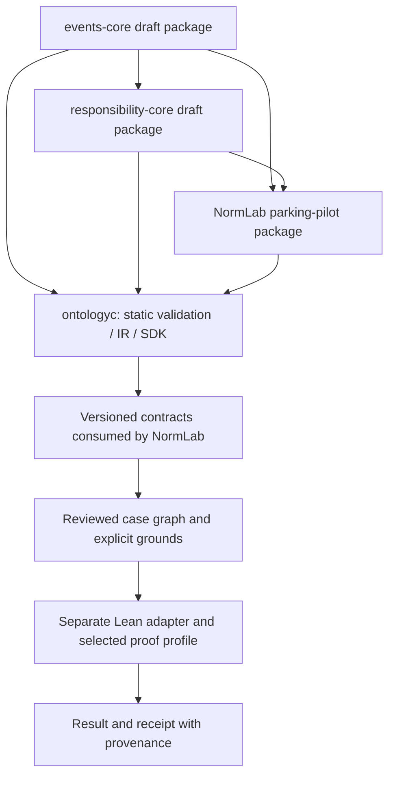
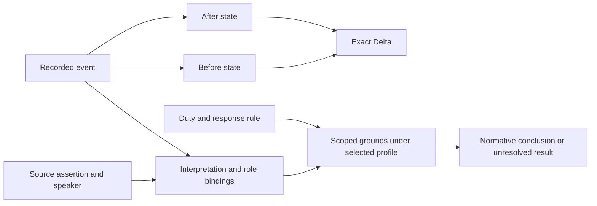

# Proposal: Event and Responsibility Core

**Date:** 2026-10-26
**Status:** Proposed design; no package or compiler implementation in ONT-041
**Task:** [ONT-041](../Workplan.md#ont-041-event-and-responsibility-core-proposal)
**First consumer:** NormLab parking PoC

## 1. Purpose and provenance

Turn the author's model into a reusable semantic dependency:

```text
Entity participates in Action/Event
  → State_before / State_after
  → Consequence = diff(State_before, State_after)
  → interpreted relations and, with explicit grounds, normative conclusions
```

Author intent: entities may act on themselves or other entities; relations can
arise from earlier actions and persist; conditions concern states; consequence
is the diff of two states. Actor is a role available to any entity, including
an abstract community, a machine, AI, or a natural phenomenon. Human contribution
and responsibility require their own grounds. Reasoning should first be checked
within isolated layers and then connected through explicit mappings.

This document proposes package contracts. It does not declare one universal
ontology or a complete theory of causation. "Responsible relation" retains the
author's working term. It is decomposed into duty, conditions, fulfillment or
breach, and a separately justified response.

Existing definitions were inspected at these immutable baselines:

- Ontology `3d0c977c61fb4f725cbc4261fa8c6efad412f12b`:
  [compiler IR](https://github.com/0al-spec/Ontology/blob/3d0c977c61fb4f725cbc4261fa8c6efad412f12b/SPECS/ontology/compiler-ir.md),
  [package schema](https://github.com/0al-spec/Ontology/blob/3d0c977c61fb4f725cbc4261fa8c6efad412f12b/SPECS/ontology/domain-ontology-package.schema.yaml).
- NormLab `e8041c937f28d3644d4df3680db5d81f0cff8ace`:
  [author principles and R1–R3](https://github.com/SoundBlaster/NormLab/blob/e8041c937f28d3644d4df3680db5d81f0cff8ace/docs/RELATIONAL_FOUNDATIONS.md),
  [R4/runtime boundary](https://github.com/SoundBlaster/NormLab/blob/e8041c937f28d3644d4df3680db5d81f0cff8ace/docs/PARKING_ATTRIBUTION.md).

Source inspection is evidence of definitions and boundaries. No new Lean proof,
compiler run, model-quality measurement, or deployed behavior follows from it.

## 2. Package and execution boundaries

The package names below are working labels; final IDs/namespaces belong to package
authoring and review. Imports must pin exact versions and resolved digests.

| Package | Owns | Consumer / ownership |
|---|---|---|
| `events-core` | Entity, event record, state projection, exact Delta, interpretation, role bindings, contextual relations, causal hypothesis | Reusable draft package and minimal examples in Ontology. |
| `responsibility-core` | Duty-bearing relation, condition, fulfillment/breach grounds, human-attribution profile, normative consequence candidate | Generic vocabulary/profile contract importing `events-core`; no parking or legal-jurisdiction assumptions. |
| `parking-pilot` | Vehicle, place, placement/payment predicates, pilot rule/version, exclusions and candidate sanction | Product package owned by NormLab; imports the generic packages. |



`ontologyc` continues to treat YAML as inert data. It owns static validation,
deterministic IR and generated contracts. A separate consumer/verifier evaluates
case-specific grounds. Package approval, operator acceptance, factual truth and
proof-profile acceptance remain distinct decisions.

The existing `objective`, `mechanics`, `execution`, `meta`, `multi_agent` layers
remain optional descriptive metadata. The state domains below are not new
`OntologyLayer` values. `modelApplicability` records assumptions and exclusions;
it does not execute them or turn a draft package into trusted law.

## 3. Proposed vocabulary and invariants

| Concept | Proposed meaning / contract |
|---|---|
| Entity | Scoped stable identity; it need not be a person, group, organization, or physical object. |
| Action | A kind of occurrence interpreted as an entity's action; its occurrence is represented by a recorded event. |
| RecordedEvent | Immutable record identity, episode, interval, known comparable before/after state references and provenance. A record is supplied evidence, not proof that an incident happened. |
| Event / interpretation candidate | Source-backed description or role proposal whose required observations or bindings may be unavailable. It is not a checked RecordedEvent or bound Interpretation. |
| State | Finite set of base facts under an explicit schema, scope and projection. Facts may describe observations, evidence/review state, or normative annotations; these domains stay distinguishable. |
| Delta / Consequence | Exact Added and Removed sets for known comparable before/after states. If either state is unavailable or partial in the selected projection, exact Delta is unavailable. Derived closure is not silently mixed into this diff. |
| Interpretation | A reading of one recorded event; carries role assignments and grounds, not replacement observations. Multiple readings may coexist. |
| RoleBinding | Interpretation + role + Entity. Actor, target and instrument are roles; membership never implies legal responsibility. |
| RelationInstance | A contextual relation occurrence with participants, interval/scope and grounds. It can persist beyond its originating action. |
| Condition | A predicate over an explicit state/history/scope, evaluated under a selected profile with preserved support. |
| CausalHypothesis | A proposed link between registered events with explicit grounds and a declared temporal profile. It is not established by temporal order or nonempty diff. |
| ResponsibleRelation | Duty bearer, counterpart, required state/action, applicability, deadline and response-rule reference. Its origin and continuation need stated grounds. |
| NormativeConsequence | A rule-derived change or candidate response. If represented as a state transition, its Delta belongs to the normative projection. |

Core invariants proposed for later executable validation:

1. Record IDs are unique inside one snapshot. A reference includes snapshot
   identity; two records under the same ID cannot silently overwrite one another.
   Separate reports of the same incident may remain separate records.
2. Checked interpretations reference a registered event. Changing roles preserves
   its before/after observations and exact consequence. Source-level candidates
   retain their assertion references while required states or bindings remain
   unresolved; they cannot be passed as checked interpretations. Unknown
   participants remain unresolved candidates; no fictitious Entity is created
   to satisfy a slot.
3. Generic records require no human actor. A profile that requires a known actor
   or human anchor checks that requirement explicitly. The current NormLab
   `RoleView` has one actor/target and optional instrument; multiple/partial role
   bindings are proposed generalization, not its present API.
4. Before/after states share schema version, identity scope and projection.
   Added = after minus before; Removed = before minus after. Order and duplicate
   serialization do not change set meaning. Reapplying the exact Delta restores
   after; exactness also excludes unrelated additions/removals.
5. Empty observed diff is allowed only when both snapshots are known and equal
   within their declared projection, including omission or prevention. Missing
   observations cannot be replaced by empty fact sets to manufacture an empty
   Delta. A known empty diff does not prove lack of effect in another projection
   or in a counterfactual situation.
6. A minimal causal profile rejects self-links, reversed intervals, and a cause
   starting after its consequence. Overlap is allowed. This is the bounded R3
   profile; global acyclicity and physical causation are not claimed.
7. Duties, capability, elapsed deadline, attribution, exceptions and performance
   require explicit scoped grounds. Ownership or launching an AI agent alone
   cannot supply the human-attribution conclusion.

### Observation availability is separate from State contents

An unavailable snapshot and a supplied snapshot containing zero facts are
different inputs. Availability is explicit metadata about a state observation;
it is separate from unknown/conflicting propositions inside a supplied State.
"Known" here means that the snapshot is supplied and complete for its declared
projection, not that the real-world narrative has been proven true. A partial
snapshot does not support an exact diff for that full projection.

| Before / after observations | Exact Delta |
|---|---|
| Both known, comparable and equal, including two known empty snapshots | Available; Added and Removed are empty. |
| Both known and comparable, with different contents | Available; exact Added and Removed are computed. |
| Either missing, explicitly unknown or partial in the selected projection | Unavailable; no computed Delta value, empty or otherwise. |
| Both supplied but with incompatible schema/scope/projection | Reject comparison until an explicit mapping is provided. |

This availability contract is proposed for InstanceGraph. The existing Lean
`RecordedEvent` still requires concrete before/after states. An exporter must
retain a source-only event/interpretation candidate when those states are
unavailable; it must not insert two empty states or copy the operator's review
states to construct a physical-event record. Later enrichment creates an
explicitly linked new record rather than rewriting the source-only candidate.

## 4. Evidence, uncertainty and interpretation

Keep assertion identity separate from proposition identity. An assertion carries
source/revision/digest, quote coordinates, speaker, episode, polarity and review
decision. Its role assignment and any accepted finding retain their own
provenance. For "I parked" inside a letter, "I" belongs to that letter's author;
an absent speaker remains unknown. Neither is automatically the narrator.

Positive support and negative support are independent. For one scoped proposition:

| Positive support | Negative support | Epistemic reading |
|---|---|---|
| absent | absent | Unknown |
| present | absent | Supported positively |
| absent | present | Supported negatively |
| present | present | Conflict |

This evidence reading is separate from workflow states such as pending,
confirmed or rejected. It is also separate from a complete Belnap connective
calculus, which the present NormLab atom/rule core does not implement. A missing
payment statement does not establish nonpayment. An omission profile needs
explicit negative support for performance as well as the other grounds.

Operator findings without a cited text fragment are allowed when explicitly
labelled as uncited operator assertions. They cannot masquerade as source-backed
findings. A structurally valid citation proves identity/scope only; semantic
relevance and sufficient polarity support need a separate accepted mapping.



The two branches are related by explicit references. The observed Delta alone
does not entail the normative conclusion.

## 5. Mapping to the implemented NormLab model

All links in this table are pinned to the NormLab baseline above.

| Proposed component | Existing definition | What is already represented / limit |
|---|---|---|
| Typed facts and bounded rules | [Relations.lean](https://github.com/SoundBlaster/NormLab/blob/e8041c937f28d3644d4df3680db5d81f0cff8ace/lean/Relations.lean) | Typed literal signatures, independent polarities, ground Horn rules, soundness/completeness. No generic package-to-rule compiler. |
| State and exact Delta | [StateRelations.lean](https://github.com/SoundBlaster/NormLab/blob/e8041c937f28d3644d4df3680db5d81f0cff8ace/lean/StateRelations.lean) | Finite base-fact sets, exact Added/Removed, roundtrip and preservation results. Not a full entity/property store. |
| Explicit derivation support | [DerivationTraces.lean](https://github.com/SoundBlaster/NormLab/blob/e8041c937f28d3644d4df3680db5d81f0cff8ace/lean/DerivationTraces.lean) | Checkable trees and support-sensitive preservation; no automatic proof search. |
| Records, roles and hypotheses | [EventTransitions.lean](https://github.com/SoundBlaster/NormLab/blob/e8041c937f28d3644d4df3680db5d81f0cff8ace/lean/EventTransitions.lean) | RecordedEvent, Interpretation, unique-ID snapshot registry, bounded causal hypotheses. No physical causation oracle. |
| Human contribution | [ActionAttribution.lean](https://github.com/SoundBlaster/NormLab/blob/e8041c937f28d3644d4df3680db5d81f0cff8ace/lean/ActionAttribution.lean) | Bound human action/omission profiles; actor and humanAnchor are distinct. |
| Parking attribution boundary | [ParkingAttribution.lean](https://github.com/SoundBlaster/NormLab/blob/e8041c937f28d3644d4df3680db5d81f0cff8ace/lean/ParkingAttribution.lean) | Requires registered events; unbound profile helpers are a separate research API. |
| Current web calculation binding | [ParkingRuntime.lean](https://github.com/SoundBlaster/NormLab/blob/e8041c937f28d3644d4df3680db5d81f0cff8ace/lean/ParkingRuntime.lean) | `recordReviewedFindings`: operator is actor/humanAnchor; after-state stores scope/findings/support links. It is a review-recording event, not a proven driver's parking action. |
| Norm calculation | [Parking.lean](https://github.com/SoundBlaster/NormLab/blob/e8041c937f28d3644d4df3680db5d81f0cff8ace/lean/Parking.lean) | Selected finding states drive the bounded pilot result. Actor identity and responsibility are not inferred from those choices. |
| Source-level actor proposals | [parking-fabula.ts](https://github.com/SoundBlaster/NormLab/blob/e8041c937f28d3644d4df3680db5d81f0cff8ace/server/parking-fabula.ts) | Versioned source/speaker candidates and immutable human decisions. These sidecar decisions do not change the Lean receipt. |

The pilot must export the operator event and source-level fabula interpretation
candidate separately. The operator event has supplied review-state snapshots;
the current fabula sidecar supplies source/role evidence without physical
before/after states. The latter therefore retains unavailable observations and
no computed physical Delta. It must not be coerced into a checked RecordedEvent
or relabel the existing operator proof as a proof of who parked, why a car moved,
or who owes a sanction.

## 6. Compiler fit and missing contracts

The existing schema can describe the vocabulary as classes, relations, protocols,
policies and state machines. A relation instance or role binding can be a node
connected through binary relations; no foundational n-ary edge primitive is
needed for the first package. Existing foundation `Actor` and `SystemActor`
kinds remain compatible; this proposal does not redefine existing packages.

Class `fields` currently support `string`, `boolean`, `integer` and `number`.
Generated object schemas and concept-ref checks do not establish integrity of a
whole event graph. Generic nested state arrays, typed instance references,
polarity enums and graph-wide constraints need a separate contract.

Propose a versioned `InstanceGraph` envelope alongside the package definition:

- package/version/digest bindings, graph/snapshot identity and declared profile;
- entity, record, interpretation, assertion and relation-instance collections;
- typed references, state projections, explicit observation availability,
  interval representation and role bindings;
- deterministic diagnostics for identity, scope and reference errors.

This is a proposed envelope, not accepted YAML syntax or a new CLI command.
ONT-043 should choose its wire schema and emit/validation surface before code
changes. Start with references and finite collections rather than a general
expression language. Domain conditions remain consumer/verifier-owned.

Lean integration remains a separate typed adapter to a pinned profile. Generated
TypeScript schemas must not be advertised as proofs of cross-record invariants.
Generic package-to-Lean generation and execution of arbitrary authored rules are
deferred until the small adapter has demonstrated value.

## 7. Competency questions and future checks

These are acceptance scenarios, not tests run in ONT-041.

| ID | Question / input | Required observation |
|---|---|---|
| CQ-01 | Can a hurricane or abstract community occupy actor role? | Yes in a generic interpretation, without invented human attribution. |
| CQ-02 | Can two readings call the car actor versus instrument? | Both preserve the same observations and Delta availability; when a Delta is available, its value is identical. |
| CQ-03 | Can an existing relation persist while its originator does nothing? | Yes; origin, continuation and termination grounds remain distinct. |
| CQ-04 | Can duplicate record IDs carry changed states? | Reject within the same snapshot; no last-write-wins. |
| CQ-05 | Does no payment statement establish nonpayment? | Unknown; omission requires explicit scoped performance and duty grounds. |
| CQ-06 | Do positive and negative payment assertions disappear? | Both remain; conflict prevents an unsupported definite profile result. |
| CQ-07 | Does "I" in a neighbor's letter become the narrator? | No; source speaker is retained, or identity stays unresolved. |
| CQ-08 | Can a causal link point to itself or backward under the R3 profile? | Reject; overlapping cause/consequence intervals may remain a hypothesis. |
| CQ-09 | Can a proof for the operator's review establish the driver's act? | No; event/profile identity mismatch is visible and not accepted as that proof. |
| CQ-10 | Does deleting an unused support invalidate every conclusion? | Unaffected certified support may survive; a used-support deletion requires revalidation or another certificate. |
| CQ-11 | Can a source-free operator finding count as cited evidence? | No; it remains an explicit uncited assertion. |
| CQ-12 | Can a different schema/scope be diffed as the same state? | Reject comparison or require an explicit versioned migration/projection. |
| CQ-13 | Can missing or partial physical states be exported as two empty snapshots? | Reject that conversion; retain a source candidate with unavailable exact Delta. |
| CQ-14 | Can two known, complete, comparable empty snapshots produce an empty Delta? | Yes, within the declared projection; availability must distinguish this control from CQ-13. |

Implementation tasks must add focused positive/negative checks before changing
their executable contracts. These scenarios do not require a paid model or a
new evaluation framework.

## 8. Bounded delivery roadmap

| Stage | Owner / task | Result and stop condition |
|---|---|---|
| 1. Draft event vocabulary | Ontology [ONT-042](../Workplan.md#ont-042-draft-event-core-package) | Source-grounded authoring artifacts and a draft package compile with the current compiler; exported vocabulary makes no new proof claims. Stop after the package and its few examples. |
| 2. Concrete graph contract | Ontology [ONT-043](../Workplan.md#ont-043-instance-graph-contract-and-validation) | Choose a minimal versioned envelope and implement identity/scope/reference validation with positive/negative checks. Do not add an expression interpreter. |
| 3. Responsibility vocabulary/profile mapping | Ontology [ONT-044](../Workplan.md#ont-044-draft-responsibility-profile-package) | Draft generic duty/omission/response package with explicit mapping to existing Lean profiles. Can follow stage 1 independently of stage 2; formal runtime stays separate. |
| 4. Offline consumer pilot | Ontology/NormLab [ONT-045](../Workplan.md#ont-045-normlab-offline-event-graph-pilot) | A consumer-owned exporter maps one saved parking episode and preserves the previous result/receipt and uncertainty. Record the evidence and stop; no new public product release is required. |

ONT-042 follows proposal review. Stages 2 and 3 depend on its vocabulary; stage 4
needs both. NormLab implementation must be linked into its own canonical Issue
ledger before work begins. The existing SpecGraph/SpecSpace applicability-consumer
[roadmap](model-applicability-consumer-roadmap.md) remains independent; this
proposal neither completes nor supersedes that work.

## 9. First pilot acceptance and remaining decisions

Use one locally saved parking episode through read-only export. Retain its full
source privately and publish only synthetic examples or authorized redacted
evidence. The graph must retain source revision/digest, speaker, episode, review
decisions, exact quote references and uncited findings. Preserve the recorded norm
result and pinned verifier/profile identity; export must not recalculate or
rewrite historical receipts with today's policy.

Demonstrate that role reinterpretation preserves observations and Delta
availability/value, and that wrong event/snapshot references are rejected.
Export the current fabula sidecar as a source-only candidate when physical
states are unavailable; do not manufacture an empty physical Delta. Include the
positive control of known, complete, comparable equal states producing an empty
Delta. Keep unknown/conflict states; do not equate legalFinding states with
source truth. An offline replay under the same explicitly pinned profile may
establish result agreement; export alone establishes only data/identity
preservation. No paid inference is needed.

Before implementing InstanceGraph, settle the wire representation of finite
facts/references, unavailable observations versus known empty states, partial-role
candidates, profile/cardinality requirements and time normalization. Before
claiming semantic evidence validation, specify the
accepted condition-to-predicate/polarity mapping. These decisions are tracked by
ONT-043/044, not silently answered by a generic string field.

Success of the first cycle is a reusable contract and one faithful consumer
mapping. Universal ontology extraction, unrestricted legal coverage, a new graph
editor, automatic responsibility assignment, and a generic theorem-code generator
remain outside this pilot.


## Motive extension — ONT-048 (2026-10-28)

The user's extension introduces **Motive** as a reason prompting an actor's action
or omission that may lead to a consequence. The user explicitly includes any
Entity actor, without requiring consciousness or intention. An instruction to an
AI or a physical influence on a machine can therefore be interpreted as a motive.

The [motivation-core draft](packages/motivation-core/README.md) separates reason
content from its actor/view-scoped MotivationHypothesis. It retains source-only
candidates, unresolved actors and independent positive/negative support. Own
change derives from the selected contribution record's states and optional exact
Delta. Hypothesized downstream consequences follow an explicit CausalHypothesis
from that exact view to the separate effect view/record and its Delta. Empty own
change does not deny downstream effects. The pilot uses a separate omission
record plus causal hypothesis, without silently substituting a movement-record
interpretation as the same motive scope. Motive attribution does not establish
a causal chain, performance,
omission grounds, fault, responsibility or sanction. Its policies are manual;
this does not change the historical ONT-041 proposal or frozen event profiles.
