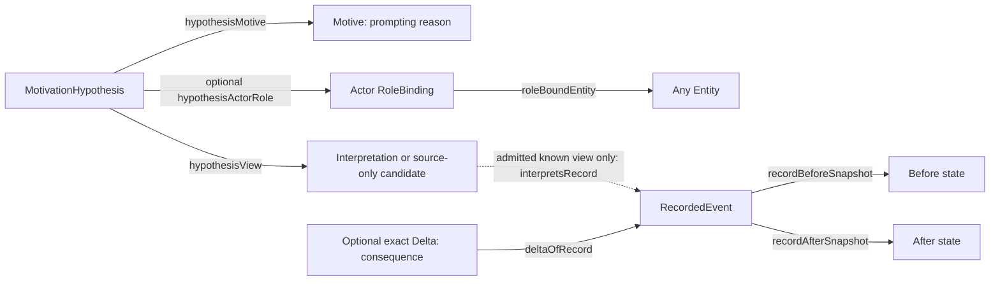

# Motivation Core — draft

`org.0al.motivation.core@0.1.0`, namespace `motivcore`, approvalStatus draft.
Imports `org.0al.events.core@0.2.0`; its exact local IR and source digest are pinned
in [motivation-binding-v1.json](design/motivation-binding-v1.json). This is an inert
semantic design contract, not an instance profile or runtime admission receipt.

## Meaning

**Motive (Мотив)** is a reason prompting an actor toward action or omission.
The actor may be any Entity: person, community, organization, AI, machine or
natural phenomenon. Conscious intention is not required. A reported desire, an
instruction, a constraint or a physical influence can be interpreted as a motive;
its meaning is actor-relative and belongs to the selected account of the event.

A motive's content is separate from its attribution: “responding to an instruction”
is reusable content, while “this instruction prompted this AI in this contribution”
is a particular MotivationHypothesis. This package records that explanation; it
does not decide whether the explanation is true or infer consciousness from it.

## Representation

The package has five classes, nine relations, six manual policies and one review
lifecycle. All ten generated IR/SDK files are produced by the existing compiler.

| Concept | Data and meaning |
|---|---|
| Motive | motiveKey, description, optional label: prompting-reason content. |
| MotivationHypothesis | hypothesisKey and contributionKind (action or omission by explicit interpretation). One motive and one existing view; actor role may remain unresolved. |
| OperatorMotivationSupport | Named operator's explicit uncited supportKey/rationale, separate from source citations and the motivated actor. |
| ReviewMotivation / RejectMotivation | Proposal workflow commands; review/rejection is not a truth value. |

hypothesisView references exactly one Interpretation or InterpretationCandidate.
If hypothesisActorRole is present, it must be a role owned by that selected view,
named actor. Derive its Entity through roleBoundEntity. Do not copy actor/event IDs
or choose a narrator by default. Missing role means unresolved actor, never a
synthetic person. Entity actors carry no human-only or intention requirement.

hypothesisPromptingEntity, hypothesisPromptingFact and hypothesisPromptingView
are optional contextual anchors for the reason. They do not themselves establish
that an influence occurred or motivated this actor. Explicit episode alignment,
valid clocks/time and distinct prompting/target records are needed before making
an ordered causal claim; those checks are manual in this draft.

## Motive, causation, goal and responsibility

Motive is the reason ascribed to this actor's contribution. CausalHypothesis
relates occurrences through interpreted registered events. They may concern the
same influence, but neither is automatically derived from the other. A physical
reason can be a motive under the user's broad definition without becoming a
mental intention; an actor's reported intention does not prove physical causation.

The **actual consequence** remains the record's exact Added/Removed difference,
when complete admitted states and a Delta are supplied. Follow the known view to
its record; do not attach an independently chosen Delta to a motive. A source-only
InterpretationCandidate may retain a motive account without a record, snapshot or
Delta. Missing states mean unknown changes, not an empty diff. Candidate resolution
must not silently rebind an existing hypothesis or generate physical observations.

A desired outcome differs from the actual consequence. No Goal class or intended
outcome inference is introduced in this task. A later fine, for example, is not
necessarily a goal or a directly observed result of parking. Nor does a motive
establish performance, an omission's duty/deadline/capability/exception grounds,
choice, fault, responsibility or a sanction. The existing NormLab norm is unaffected.

## Evidence and uncertainty

Each positive/negative support link references either an exact SourceAssertion
or an explicit OperatorMotivationSupport. Speaker, author and motivated actor may
be different entities. “I” in a letter keeps its source speaker; it is not silently
assigned to the narrator. Quote/revision/digest/offsets stay on the source assertion.
An unsupported model proposal can remain proposed with no invented evidence/author.

| Declared support for one hypothesis | Description, not factual truth |
|---|---|
| Neither positive nor negative | Unknown / unsupported. |
| Positive only | Supported. |
| Negative only | Explicitly opposed for this attribution. |
| Both | Contested; preserve both accounts. |

These are derived support-presence descriptions, not a cached truthState field.
An absent hypothesis does not assert that no motive exists. Distinct motives may
coexist without exclusivity; no “strongest motive” or probability is calculated.
Removing support does not invent negative support. MotivationReview uses proposed,
reviewed and rejected states, independently of the evidence. Rejected does not
erase a source or prove absence of the motive; reviewed does not make it true.

## What is checked now

Compiler validation checks package syntax/references and declaration consistency.
Generated Zod schemas check scalar object shapes and discriminators; the runtime
smoke exercises required fields and wrong primitive types. The CI generation gate
checks the exact event dependency pin and all imported class refs.

**All six policies remain manual.** Relation cardinality, selected-role ownership,
actor/episode identity, contributionKind enum, clock/order, semantic relevance,
source authenticity and motivation truth are not checked by these object schemas.
The MotivationReview semantics above are declared workflow, not executed instance
history. No new instance validator/profile, Lean theorem or adapter is delivered.

Existing eventcore-v1 and eventcore-provenance-v1 admit only their pinned event
vocabularies; they do not accept motivcore nodes or relations. Physical provenance
confirmation never confirms a motive. A future consumer must agree and validate
an explicit contract, keeping historical graphs/results/receipts unchanged.

See [examples.md](examples.md) and [authoring/competency-questions.md](authoring/competency-questions.md).
No NormLab code/tests, paid inference, deployment or automatic legal result change.
