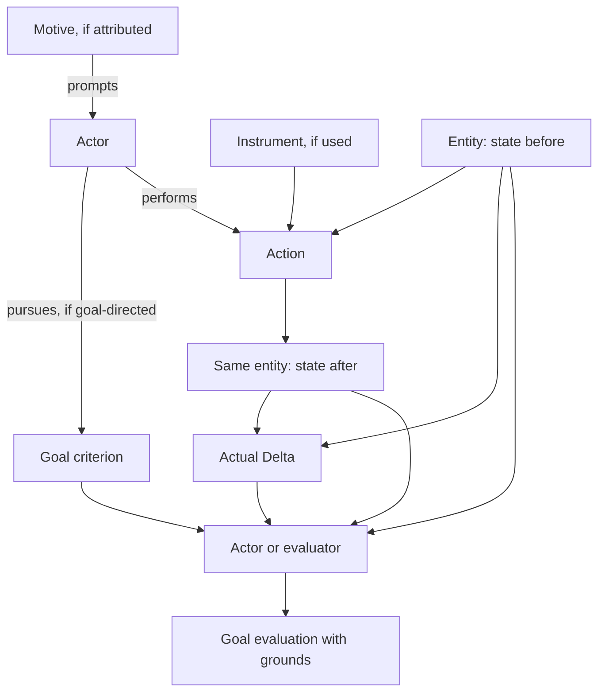

# Minimal action model for application behavior

Version: documentation pattern 1, 2026-10-28. This is a modeling convention and
worksheet, not a new ontology package, accepted InstanceGraph format or executable
goal language. The [image-encoding example](image-encoding.md) applies the pattern.

## Choose a bounded behavior

Start with the entity affected by one action, its identity rule, the participating
roles and the observable transition. Add only the concepts needed to explain that
behavior. A person, machine, service, community or natural entity can occupy the
actor role. Motives, goals and responsibility are optional; the pattern does not
make every event intentional or goal-directed.

For an application, stay inside the requested domain boundary. A request to model
image compression does not imply modeling app development, distribution, hardware
or billing. UI controls and processing components enter only through their relevant
roles. Do not replace a domain model with a list of implementation classes.

## Entity, action and relation

| Concept | Question to settle |
|---|---|
| Entity and identity | What is affected, and what makes it the same entity across time? |
| Actor role | Which entity acts in this interpretation? |
| Action or omission | What contribution is being described, over which interval? |
| Object role | Which entity is affected? The actor and object may be the same entity. |
| Instrument role | Which entity is used to perform the action, if any? |
| Relation | How do those participants relate through this action, in this scope? |
| State before and after | Which relevant properties are known at each boundary, from what observation? |
| Consequence | What actually changed between these states? |

Name relations in domain language, such as “transformation of an image.” An operator
is the transforming subject, an image the object and an encoder the instrument for
this action. This role does not need a permanent entity subclass called Compressor.
The example illustrates an action-mediated relation; it does not require every
possible relation to be a currently executing action.

Identity is an explicit model decision, not a consequence of matching filenames.
In an in-place image model, a stable document identity can survive replacement of
the underlying file. A copy-producing model instead needs a new identity and a
derivation relation. Do not switch between those readings halfway through a trace.

## Actual consequence and goal criterion

For one recorded transition, write:

```text
transition = (entity identity, event identity, S_before, S_after)
Delta = diff(S_before, S_after)
evaluation = evaluate(goal criterion, transition, Delta, relevant context)
```

The goal specifies a criterion. An actor or a designated evaluator applies it.
Evaluation is a separate operation; a goal is not itself an acting entity.

The criterion can inspect different parts of the same transition:

| Criterion | Example | Needed observations |
|---|---|---|
| Post-state | Final size <= 500,000 bytes | Final size |
| Relative change | Reduce size by at least 200,000 bytes | Before and after size, or their trustworthy scoped difference |
| Exact change | Reduce size by exactly 200,000 bytes | Same operands, with equality instead of inequality |
| Preservation | Keep width and height unchanged | Both dimensions before and after |
| Combined | Required reduction while preserving dimensions | All operands above |
| Maintenance | Keep a property within bounds throughout an interval | Appropriate observations over that interval, not endpoints alone |

Use a sufficiently expressive criterion over a transition/history. A scalar size
difference alone cannot answer every final-state or preservation question, while
the final state alone cannot answer every relative-change question. A structured
Delta can retain old/new values for changed properties; unchanged properties still
need the relevant state/context. Record the observation projection being compared.

For relative size, distinguish the signs:

```text
size_change = size_after - size_before
reduction = size_before - size_after = -size_change
goal: reduction >= requested_reduction
```

Set units and the comparator explicitly. Here 1 kB = 1,000 bytes and 1 KiB =
1,024 bytes. “200 kB smaller” may mean exactly or at least 200,000 bytes. If the
user has not chosen, label a provisional assumption instead of silently switching
between the meanings. Consider feasibility: some criteria cannot be met for a
given source or under the preservation constraints.

Keep these observations separate:

- Operation outcome: completed, failed, cancelled or pending, according to the
  application's chosen contract.
- Goal evaluation: `satisfied`, `not_satisfied` or `unknown`, with the criterion,
  referenced observations and reason. This is a proposed application convention.

Missing operands never become zero, an empty state or an empty Delta. Report
`unknown` when required information is insufficient. A post-state criterion can
still be evaluated if only its final-state operand is known. For a conjunction,
one known-false condition suffices for `not_satisfied`; otherwise unresolved
necessary conditions prevent `satisfied`. Invalid/foreign identities are a scope
validation failure, not a meaningful measurement. An unknown physical candidate
can remain source-only without constructing a recorded transition.

## Motive, goal and observed result

A motive is an attributed reason prompting the actor's contribution. In a
goal-directed account it may explain pursuing a goal, but motive and goal are not
synonyms, and neither implies the other universally. Conscious recognition,
intention, prediction and preference are additional independent claims.

A user may explicitly state a goal, select a preset, or supply an explanation.
Record that origin. Moving a slider alone does not establish a motive, a target
file size or a commitment to complete the operation. A successful result does not
reconstruct a prior goal; a desired result is not an observed consequence.



Arrows express the selected account, not proof of psychological or physical
causation. The picture is a minimal pattern; omission, creation and multi-event
chains may require a different shape.

## Interpretations and implementation boundaries

For the same encoding event, two interpretations may bind:

1. Operator as actor; image as object; encoder as instrument.
2. Encoder as actor; image as object; operator as initiating participant.

The recorded states and actual Delta stay fixed. The second view does not inherit
the operator's motive, goal or intention automatically. An encoder implementing a
declared optimization objective is different from an encoder executing a supplied
quality parameter; neither description requires attributing a conscious desire.

If “operator sends request” and “encoder performs transformation” are separately
modeled, they are distinct events with their own boundaries. That is decomposition,
not merely a role reinterpretation. Add an explicit causal hypothesis or a specified
protocol dependency when needed; temporal ordering alone establishes neither.
This minimal template does not construct a causal chain automatically.

The chosen view informs command ownership, evaluation responsibility and tests,
but does not force a one-to-one mapping from entities/relations to classes/services.
If relevant, add a component obligation explicitly (e.g. preserve the original on
failure). Do not infer responsibility, authority or a promised numerical outcome
merely from the actor/instrument label.

## Mapping to current Ontology vocabulary

| Pattern element | Existing vocabulary / boundary |
|---|---|
| Participants | Entity and RoleBinding, reached through the selected Interpretation or InterpretationCandidate |
| Known transition | RecordedEvent, StateSnapshot, Delta; admit under the explicitly selected profile and provenance rules |
| Unknown physical event | EventCandidate with source-only/partial observations; no fabricated snapshots |
| Prompting reason | motivcore:Motive with independently supported MotivationHypothesis |
| Goal account | agencycore:GoalHypothesis targeting PropositionContent |
| Transition criterion | Descriptive content on a situation/history; no new expression syntax or executable evaluator is supplied |
| Goal evaluation | Application-owned decision and evidence; not a new compiled class in this guide |

`agency-source-attribution/v1` checks bounded schema/reference agreement, not goal
satisfaction. Its authority flags remain unchanged. Package generation, structural
validation, provenance admission, test outcomes and factual truth are different
claims. Existing reports and profile versions are not reinterpreted by this guide.

## BDD, Gherkin and property-based tests

BDD helps the team agree on behavior using concrete examples. Gherkin records
those examples. They become executable acceptance tests only after step definitions
connect them to the application and independently observable outcomes. See
[Cucumber's BDD guide](https://cucumber.io/docs/bdd/) and
[Gherkin reference](https://cucumber.io/docs/gherkin/reference).

| Gherkin part | Mapping |
|---|---|
| Given | Initial state, identity, scope, declared criterion and necessary preconditions |
| When | Action by a selected actor, using the instrument/configuration as relevant |
| Then | Observable consequence and goal evaluation; compare with the retained baseline when relative |

Keep hidden internals out of acceptance assertions unless they are the actual
consumer contract. A state transition within an evaluator component may be tested
with supplied measurements; an encoding E2E test must obtain observations from the
codec/file, not insert the expected output as if the codec produced it.

Property-based testing (PBT) explores generated inputs and edge cases against a
property. [Hypothesis](https://hypothesis.readthedocs.io/en/latest/) is one example
framework; choosing it is not required by this pattern. Sampling and shrinking can
find counterexamples; passing samples is not a universal proof.

Useful property designs, with their domains explicitly restricted:

- **Threshold boundary:** for finite nonnegative integer byte measurements and an
  at-least target, reductions immediately below/equal/above it give false/true/true.
  For exact reduction, above the threshold is false. Include growth and zero change.
- **Baseline sensitivity:** two transitions with the same final size but different
  initial sizes can have different relative-goal results. Detect an evaluator that
  accidentally checks only the final state.
- **Evidence sufficiency:** removing a necessary operand cannot produce a new
  `satisfied` claim. The result may remain false if another conjunct is known false.
- **View invariance for measurement-only criteria:** changing role interpretation
  while retaining the same observations and criterion preserves evaluation. This
  does not apply to criteria explicitly depending on the actor or role.
- **Delta consistency:** recomputing a Delta from the selected snapshots agrees
  with the reported changed properties. Use semantic values, not fact-node IDs.
- **In-place identity and preservation:** successful writes preserve document
  identity and any explicitly promised dimensions. Apply only to the declared
  in-place/no-resize mode, not export or resize operations.
- **Failure behavior:** if atomic replacement is promised, injected failures before
  commit leave original bytes unchanged and do not report an unperformed transition.
  This property requires implementation evidence; it is not universally true of writes.

Do not assume lower quality always produces fewer bytes, repeated lossy encoding
is idempotent, all sources can meet a requested size, or a quality setting measures
visual fidelity. Any such invariant needs a specific codec contract and evidence.
For meaningful mutation checks, deliberately ignore the baseline, substitute zero
for missing input, invert the reduction sign, or use `>` instead of `>=`: the
corresponding properties should reject those implementations.

Use the [worksheet](../assets/action-model.md) to specify the domain, observations,
criterion, examples and properties before choosing step bindings or PBT generators.
